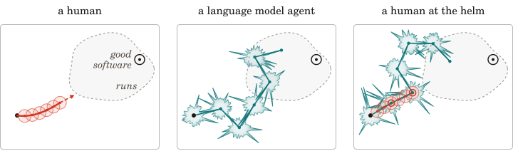
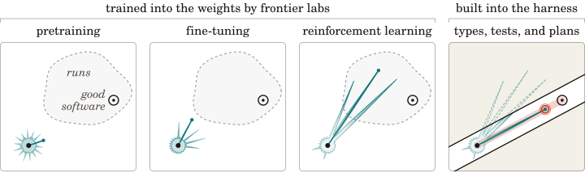
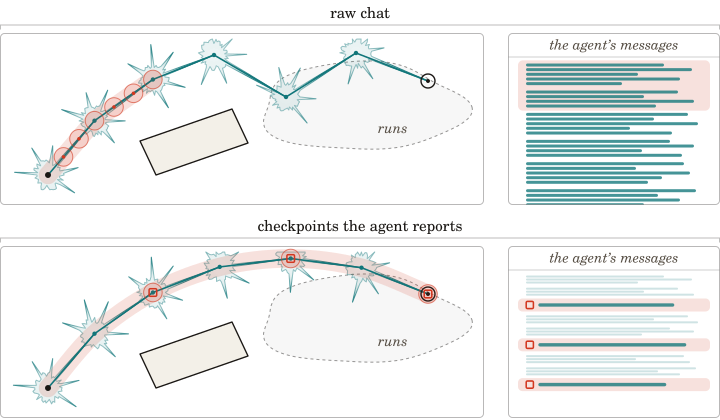
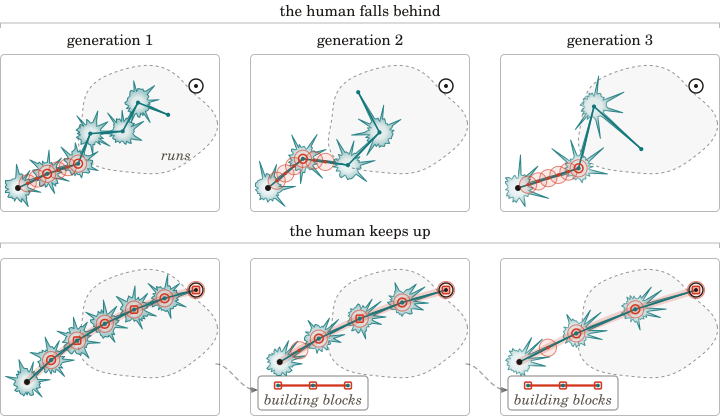
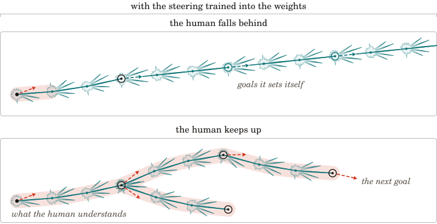

# a tiny project

This project is an experiment in large-scale engineering with language model (LM) agents. 

It serves two purposes. 

- The first is as an experiment, testing the hypothesis that agents can be coerced
to write high-performance software. Coercion here roughly means _aligned, with some sort of structured context management_
through tools, including programming languages and systems.
- The second is as a source of high-performance programmable software, for usage more generally
  (beyond the purview of seeing _if agents can write this stuff_: we want it to be useful! To
  laypeople, to scientists, etc)

In any case, it should be abundantly clear ahead of time **that agents are being used to write this software**.
This project does not seek to hide that, *it is the entire point of the project*.

We dream of a world where users can quickly spin up customized high-performance software
for their open access computing devices, without having to reinvent the universe
(indeed, *this project* might serve as such a universe, or as source for your own universe).

If you find our work useful, you might cite the project from the citation key
at https://a-tiny-project.github.io/

## Comments on software and agents

Agents are now capable enough to allow anyone to rapidly spin up new software. This is awesome!
Software deserves to be democratized! Assume that anyone can write any piece of software, what
is the value of the software produced by a project such as this?

Answering this question is analogous, in many ways, to the existential crisis confronting mathematics.
In general, anyone can spin up a piece of software ... but not everyone can do it _well_.

(whether you want “well” depends drastically on what you’re doing, of course!)

At least for
today's agents, what you get out _remains_ a function of what you put in. Here, 
we (and presumably also you) want someone
who is motivated to carefully understand what they are doing at the helm ... a.k.a someone 
who is in it _for the love of the game_ (the game in this case is some combination of PL and systems, etc).

We love the game, and want to understand it!
We’re also interested in the idea that we might teach agents “the game” (can you teach agents good PL / systems design?)

### Agents are programmable search processes

Programming with agents involves programming a search process. Inside the large space of software that runs sits a region (our region of concern in this project), 
let's call it "good software": this is software aligned with very human concerns (performance, compositional design, programmability, and so on). If you don't
care about this, that's fine, but we do (people care about a lot of weird things), so we're going to talk about it.

Our question is simple -- how do we program the agent search process to find / prefer this space?

A human programmer searches in small steps. An agent (a language model working in a loop with tools) takes longer (and more frequent!) steps, which we call _leaps_. 
At any point in the search, the agent has many possible next steps, some more likely than others. 
We draw this _distribution of next steps_ as a jagged teal ball, and each leap as one draw from it.

  

_On its own (center), the agent (teal) often ends in software that runs (dashed region), but perhaps not inside the ring of good software. A human (red) has a budget of six small steps, and reading one leap costs three. At the helm (right), the human reads the first two leaps. At each, the human accepts the draw that keeps the path's direction (red rings) over a longer one that turns away. Past the second leap, the path turns sharply and zigzags._

Frontier labs program part of the agent's search into the model's weights, through pretraining, fine-tuning, and reinforcement learning. They train toward software that runs and, 
using human preference data, toward what people generally want from software. Of course they want good software, and if there was an RL environment that could 
computably represent the preferences which induce this space, they'd use that too and we'd all be happy. Perhaps that will happen in 2026 and we can shut this project down,
and live in a utopia of good PL design.

... but in the meantime, all of this training happens before the model encounters _our project_ and _our concerns_, so it cannot account for them entirely from training. 
We program it after training through the _harness_ (the tools, tests, context, and languages around the model), which a human can read and change.

  

_Training moves the distribution's mass from a dense core (pretraining) out along progressively longer spikes (fine-tuning and reinforcement learning). The longest spikes end in software that runs, all to one side of good software. In the harness (right), types, tests, and benchmarks act as walls (shaded) that remove the steps they rule out, and a plan held by a human (faint red band) bends one spike toward good software._

### Agents programming themselves

The [Mismanaged Geniuses Hypothesis](https://alexzhang13.github.io/blog/2026/mgh/) proposes training models to decompose and manage their own work 
(essentially: can we design harnesses that get out of the way ... programmable in such a way that the 
agent can use the 
programmability to increase the set of tasks it can solve using decomposition). 
We strongly align with the intuitions
behind this hypothesis for harness design (and, of course, training agentic LMs within harnesses) 
inasmuch as _humans are kept in the loop_. This is counter to the dominant narratives in
agents, which, in extreme forms, seek to remove humans from the loop. 
We want humans (yes, often multiple, as part
of great organizations that do great work) in the loop. Agents can be right there as well, of course!

This rests on a simple premise:
_if you remove yourself from the loop, you can no longer verify that the thing is what you wanted_

There are degrees of verification, and the programming of the space of strategies for verification is,
of course, a great concern. But at the very least: we want humans in the ring, verifying, thinking, etc!

To draw the contrast, there's this term "recursive self-improvement". This term seems to 
apply to _agentic LMs training agentic LMs_, but the term has also been commandeered a bit to refer to harness
programming strategies.

This term doesn't make much sense to us: we're concerned with humans: we ask whether a 
human can keep up with the loop, and steer it, as the loop scales ... because otherwise wtf are we doing? 
RSI (and the systems its proponents seem to propose that we consider) offers that we take the role
of observers on some inscrutable agentic execution trace into the future, 
whose goals we don't understand (the _acceleration_ is just too large for us to keep up).
In other words, we become passengers in an evolving world which we can no longer meaningfully
contribute to, deferring all questions and their answers to a magic box in the sky.
Okay, we ask, bluntly: who the fuck would want this?
Apparently, a religion is indeed a viable business strategy.

The most charitable interpretation of RSI as "only" leading to agents of increasingly
more degrees of _helpfulness_ seems to require a nearly complete solution to the question of alignment.

Alignment, of course,
has many levels -- but we're mostly concerned with "individual" alignment (tools and systems that
work well for the individual, furthering them towards their goals). 
Perfect individual alignment seems to be: a system
which is exactly aligned with my goals (which, by the way, I don't even know very well) but can
accomplish them at increasingly fast speeds. Of course, individual alignment with a sufficiently powerful
autonomous system is dangerous, and so labs are also concerned with "global" alignment and safeguards.

(RSI _as a scientific endeavor_ is perfectly acceptable, but we all know that RSI is not just a scientific endeavor ...)

### The search for interaction models which scale well

Back to humans. How do we keep up? The answer depends on what the human reads. An agent's raw chat (every message, tool call, and edit) quickly exceeds what a human can read. If the agent reports its work as checkpoints, at a high level and in a language a human can read, the same work fits in a few messages.

  

_Reading the agent's raw chat (top) costs three red balls per leap, so the human's six balls cover the messages for two leaps. The soft red area of what the human understands stops there, and past it the path zigzags. With checkpoints (bottom), the agent reports one entry (red square) every two leaps, the human reads each with one red ball, and the soft red area covers the whole route._

Each new generation of models leaps further than the last. If a human reads each leap in steps of human size, each generation leaves the human further behind. But the cost of reading a leap depends on how surprising it is. On a smooth path, where each leap continues in the direction of the last, reading is cheap. We therefore seek _interaction models_ (ways for a human and an agent to work together) in which the cost of reading a leap grows more slowly than its length. If reading a leap of length L costs about Lα human steps, we want α below 1, so that a stronger agent leaves the human less far behind.

  

_Each of three generations of models leaps 1.4 times further than the last. In the top row, the human reads in steps of human size, so reading one leap costs three, then four, then six red balls, and the six balls cover fewer leaps in each generation. Beyond them the agent scatters. On a smooth path (bottom), where each generation's checkpoints carry over as building blocks (dashed arrows), reading a leap costs about the square root of its length (α ≈ 0.5), and the agent reaches good software in 6, then 4, then 3 leaps._

Suppose that the steering itself is trained into the weights, as preference training already does in part. The path then stays smooth without a human reading any leap. But training cannot choose the goal, because what counts as good software depends on the task and on what the people working on it understand. A human then keeps up in order to understand the work. We value that understanding for its own sake, and we need it to choose the work's next goal.

  

_With the steering trained into the weights, the agent takes twelve smooth leaps in both rows. In the top row, the soft red area of what the human understands covers only the first leap. Past the first goal, the agent sets its own goals (teal rings and arrows) every three leaps along its current direction, and its last leap runs out of the frame. In the bottom row, the soft red area covers all of the work, and the human chooses each next goal (red arrows to ink rings)._

Two further figures, on how the harness prunes a single step and how the checkpoints of one run become building blocks for the next, are on [a separate page](https://github.com/a-tiny-project/.github/blob/main/profile/figures.md).

### The ultimate goal

At the end of the day, we enjoy fast
programmable software, and wish to see
more of it in the world. This endeavor
seems worthy of our tokens.

## Licensing

All work, unless otherwise specified, is licensed under AGPL v3.0 
(which, as is abundantly clear, is mostly symbolic these days 
-- but we hope it warms the hearts of a few)

If the idea of this project proves valuable, we fully expect people to reverse 
engineer or clean room reconstruct things they want. We've done the exact same here!
There are countless projects that we've drawn upon (and we collect and propagate
their licensing, and maintain references and commentary on influences in the READMEs
throughout our systems).

We can't really stop people going wild with agents. That's fine: use this project if you feel
like you can trust the contributors here to steer the agentic traces in good directions.

## Note on childlike play

We like to have a bit of fun with our software: we hope you find a bit of playful chaos 
in some of our releases. In the words of _The Little Schemer_, bon appetit!
