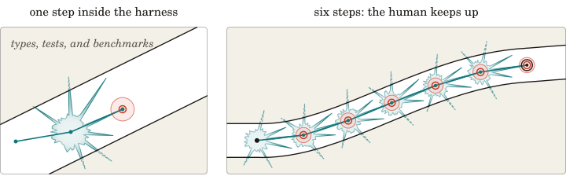
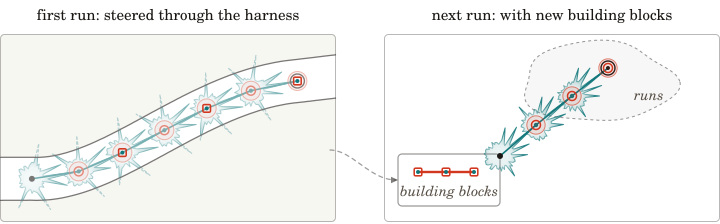

# How the harness helps a human keep up

These two figures accompany the comments on software and agents in our [organization README](https://github.com/a-tiny-project), with the same marks: red indicates the human, teal indicates the agent, and each jagged ball is the agent's distribution of next steps.

Within the harness, types, tests, and benchmarks act as walls. Each wall removes the part of a step's distribution that fails it. Among the remaining spikes, a human chooses the one that keeps the path's direction toward good software, even over a longer one, because it makes more progress.

  

_The walls (shaded) cut the spikes that cross them (dashed beyond the wall). Of the three remaining spikes, the human accepts the one that turns by 14 degrees (red ring) over a longer one that turns by 47. Each leap costs one red ball to read, so the six balls that read two leaps in the README's first figure read all six leaps here._

The checkpoints of a steered run are written in a language a human can read, so they can serve as building blocks for the next run. The next run inherits the building blocks and their context while the model's weights stay fixed. We might teach agents "the game" in this way.

  

_A steered run (faded) has three checkpoints (red squares). As building blocks for the next run, they bend the distribution toward a new goal, which the agent reaches in three leaps at one red ball each._
